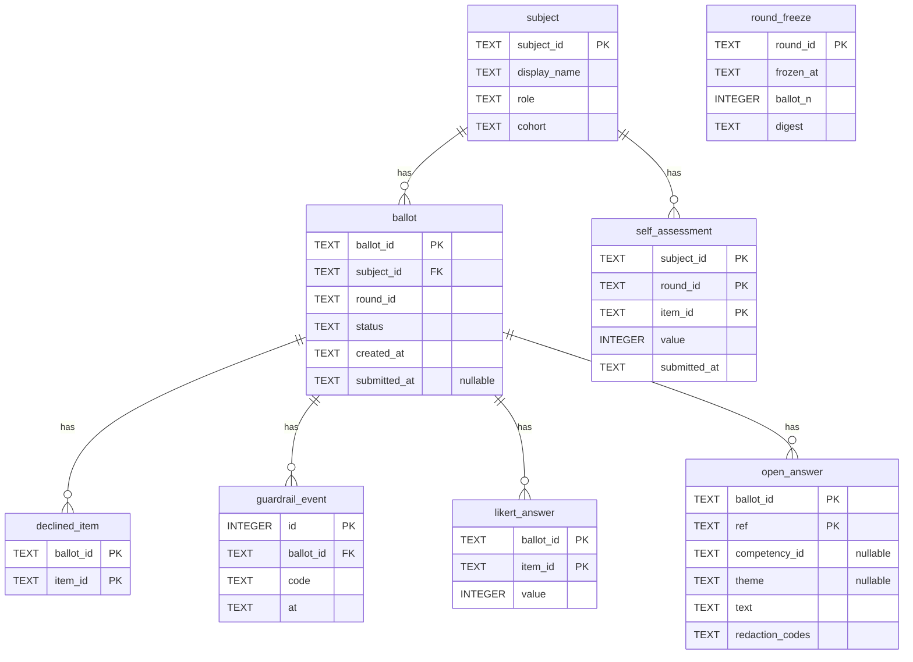

<!-- Generated by `python -m poc.cli_diagram`. Do not edit by hand. -->

# Data model

Derived from a freshly initialised database, so it tracks `poc/store.py`.

## Which side of the boundary

| Table | Side | Why |
|---|---|---|
| `ballot` | 🔑 pseudonymous — resolvable by HR | One reviewer's submission. Holds no identity column; `ballot_id` is the handle the identity side resolves. |
| `declined_item` | 🔑 pseudonymous — resolvable by HR | Items a reviewer marked "not observed". Records that no rating exists, never a score. |
| `guardrail_event` | 🔑 pseudonymous — resolvable by HR | Code and timestamp only. Never the text that triggered it. |
| `likert_answer` | 🔑 pseudonymous — resolvable by HR | Scores, keyed only by ballot. |
| `open_answer` | 🔑 pseudonymous — resolvable by HR | Free text **as written**. Masked at render time for the subject's copy, not on the way in. |
| `round_freeze` | ⚙️ operational | Immutable digest taken when the window closes. |
| `self_assessment` | 👤 attributable by design | The subject's own ratings. Excluded from every aggregate. |
| `subject` | 👤 attributable by design | Who is being reviewed. Named on every report by design. |

## Where identity lives, and who can resolve it

**No table above carries a reviewer's name, email, role or relationship.** The response store is pseudonymous: every row hangs off a `ballot_id` and nothing more. `tests/test_identity_separation.py` asserts that against the live schema, so adding such a column later fails the build rather than leaking quietly.

**But pseudonymous is not anonymous, and this round does not pretend otherwise.** Following the client's demo-2 clarification, HR administers the round and is entitled to see who reviewed whom and what they wrote. The mapping `ballot_id -> reviewer` lives on the identity side — `data/invites.json` in this POC, `identity.db` in the full build — and `app.rounds.rater_labels()` is the one function that resolves it. `poc.reporting` never looks it up; a caller holding both halves passes it in. So every attribution path is one somebody wrote on purpose, and a leak of this database alone still discloses no reviewer.

**What the split still buys, now that HR can attribute:**

* A reviewer's team, role and relationship never travel with the response, so even the HR copy cannot be broken down by role — the brief's requirement, and the one part of it this change leaves intact.
* The subject's copy is rendered from the same rows with masking applied and no attribution, so what protects the reviewer is a render decision that is tested, not a hope about who opens which file.

## What the subject's copy does NOT contain

`open_answer.text` holds the sentence as the reviewer typed it. Masking runs on the way *out*, in `poc.reporting`, keyed on audience — `AUDIENCE_SUBJECT` strips names, contact details and role-disclosing phrases and attributes nothing; `AUDIENCE_HR` does neither. The default is `AUDIENCE_SUBJECT`, so a caller that forgets to say who is reading gets the protective rendering.

The cost of moving masking out of the write path, stated plainly: a raw answer now reaches disk, where previously it could not. The 12-month raw-retention rule in `reporting-rules.yaml` is what bounds that, and it is now doing real work rather than describing rows that were already scrubbed.

The self-assessment sits in its own table rather than as a flagged ballot. Marking one ballot in a pool of two or three as "the self one" would identify the remaining reviewers by elimination, so the response pool never carries a role marker at all.
