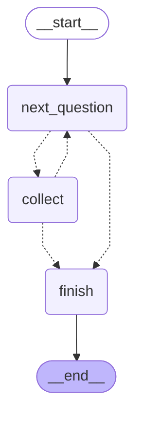

<!-- Generated by `python -m poc.cli_diagram`. Do not edit by hand. -->

# Conversation engine — compiled graph

Emitted from the compiled LangGraph app, so it cannot drift from the code.

**Solid** edges are unconditional; **dotted** edges are conditional.

| Node | What it does |
|---|---|
| `next_question` | Decides what to ask. Pure Python; writes the question into state before the graph suspends. |
| `collect` | Receives one answer: guardrails, then redaction *scoring* (the text is kept as written), then the specificity judge. Routing off the verdict is `if`, never the model. |
| `finish` | Terminal. The only node that writes to the response store, and only on consent + submit. |

The two-node loop is deliberate: one rater turn per node invocation means every turn produces its own checkpoint, which is what makes save-and-resume exact rather than approximate. `thread_id` is the ballot id.
